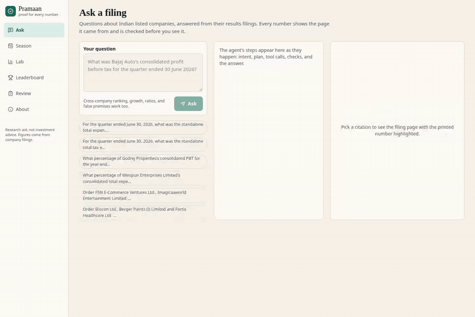
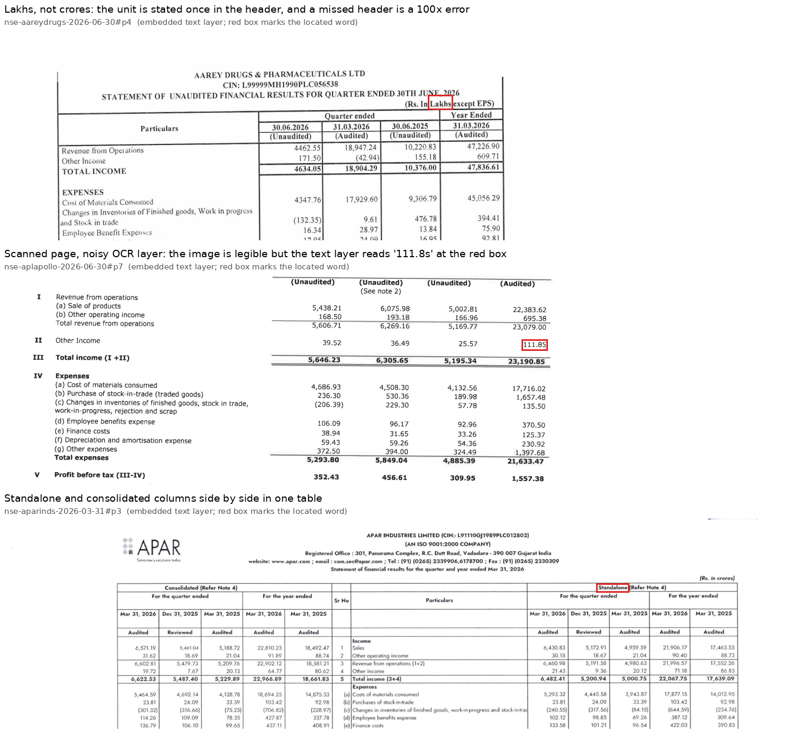
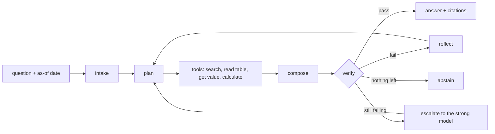
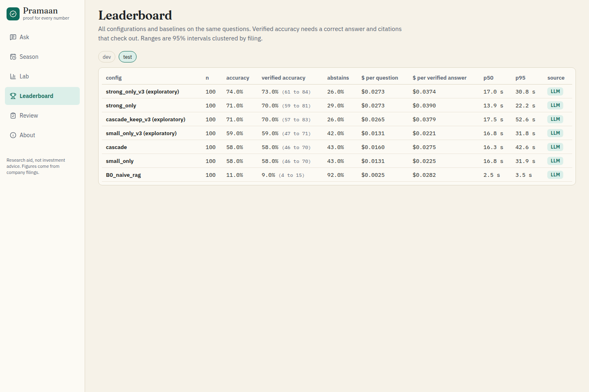
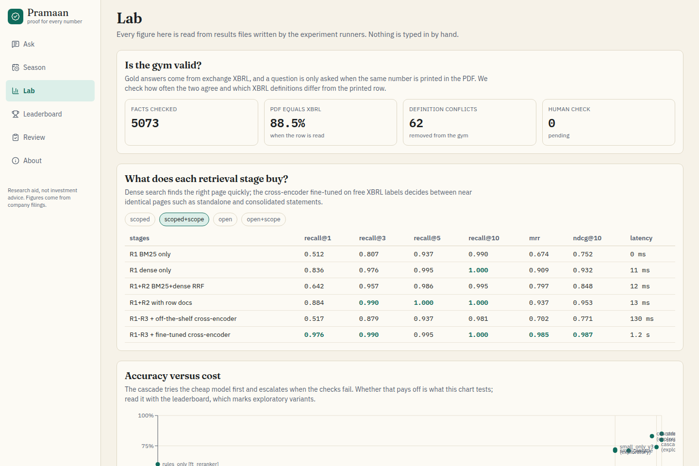
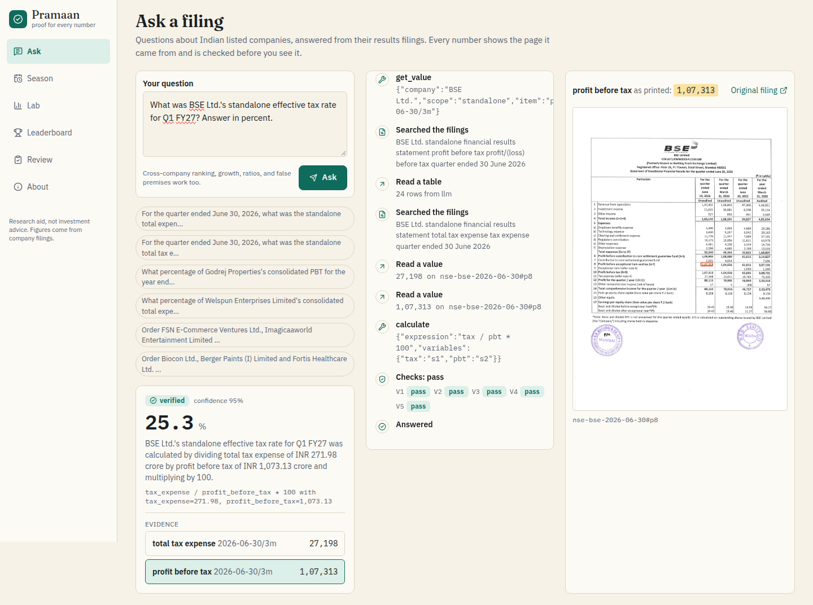
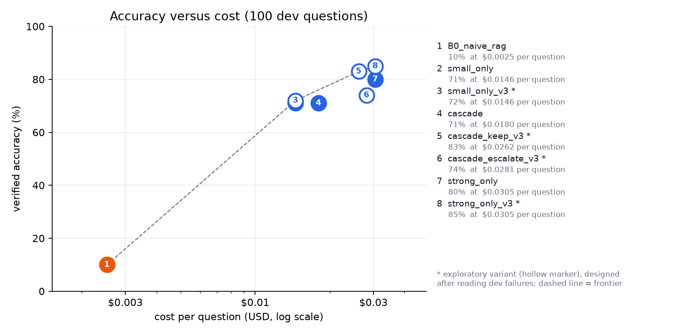

# Pramaan

**A research agent for Indian company filings that shows its proof.** Ask a question about a listed company's quarterly results; Pramaan answers from the filed PDF, cites the exact page and printed figure behind every number, and checks the answer before showing it. Answers are graded automatically against the exchange's machine-readable XBRL filing, which arrives after the PDF.



<sub>Demo of the web app replaying a recorded answer ([MP4](docs/img/demo.mp4)). The agent finds the two figures on BSE's results page, computes the ratio with a calculator (the model never does arithmetic), passes five checks, and highlights the cited numbers on the filing page.</sub>

## Why it works

Since April 2025 a listed company in India files its signed results PDF and, shortly after, the same numbers as **Integrated Filing XBRL**. The PDF comes first, so an agent has to read it, and the XBRL that follows is a free answer key. That gives three things without human labelling:

1. **A benchmark that refreshes every quarter.** Questions, gold answers and gold pages are generated from XBRL, so the benchmark can be rebuilt each quarter and cannot already be in a model's training data.
2. **Retrieval labels.** The page where an XBRL number is printed is a relevance label, which is enough to fine-tune a reranker.
3. **Automatic grading.** Every answer is checked against the XBRL value once it lands.

Real filings make this hard: tables printed in lakhs, crores or millions with the unit stated once, scanned pages with a noisy OCR layer, and standalone and consolidated statements with near-identical rows.



## How it works



* **Retrieval:** BM25, dense embeddings and row-level documents fused with RRF, then a cross-encoder fine-tuned on the free XBRL page labels (training uses train-split filings only, enforced in code).
* **Agent:** a planner-executor with typed tools. The model never does arithmetic; an AST calculator does.
* **Verification:** quote on the page, recomputation, unit sanity, accounting identities, period check and an XBRL cross-check. An answer that fails is retried, escalated or withheld.
* **Evaluation:** a chronological train/dev/test split with an as-of guard (tools only see documents published before the question), a test split guarded in code with every access logged, filing-clustered bootstrap intervals, and paired McNemar tests.

## Results

One quarter (June 2026, a dry run of the pipeline): 248 filings, 1,069 generated questions in six tiers (lookups, growth, ratios, share of year, cross-company rankings, and abstain or false-premise questions). Small model `claude-haiku-4-5`, strong model `claude-sonnet-5-5`.

<!-- RESULTS:START -->

### Held-out test sample

| config | n | accuracy | verified accuracy | abstain | $/question | $/verified correct | p50 ms | p95 ms |
|---|---|---|---|---|---|---|---|---|
| strong_only_v3 (exploratory) | 100 | 74.0% | 73.0% (61.3 to 84.2) | 26.0% | $0.0273 | $0.0374 | 17040 | 30791 |
| cascade_keep_v3 (exploratory) | 100 | 71.0% | 70.0% (57.4 to 82.7) | 26.0% | $0.0265 | $0.0379 | 17464 | 52647 |
| strong_only | 100 | 71.0% | 70.0% (59.0 to 81.4) | 29.0% | $0.0273 | $0.0390 | 13900 | 22241 |
| small_only_v3 (exploratory) | 100 | 59.0% | 59.0% (46.5 to 71.4) | 42.0% | $0.0131 | $0.0221 | 16848 | 31790 |
| cascade | 100 | 58.0% | 58.0% (45.6 to 70.3) | 43.0% | $0.0160 | $0.0275 | 16334 | 42593 |
| small_only | 100 | 58.0% | 58.0% (45.6 to 70.3) | 43.0% | $0.0131 | $0.0225 | 16830 | 31857 |
| B0_naive_rag | 100 | 11.0% | 9.0% (4.2 to 14.7) | 92.0% | $0.0025 | $0.0282 | 2475 | 3451 |

(exploratory) marks variants whose flags were chosen after reading dev failures; one counts as confirmed only if the 95% interval of its paired gain over its specified parent is above zero (see the report). The preregistered configs are the rows without the mark.

<!-- RESULTS:END -->

*Verified accuracy* counts an answer only if it is correct **and** its citations check out. The test sample is 100 of the 295 test questions, read once per configuration under a plan written before the first test access.

**What the numbers say**

* **The agent beats naive RAG by a wide margin:** `small_only` is +49 points over B0 (95% CI +37 to +61, McNemar p < 0.001).
* **Fine-tuning the reranker on free labels fixes retrieval:** page nDCG@10 goes from 0.75 with an off-the-shelf cross-encoder to 0.99 (dev, 207 questions). The off-the-shelf reranker was *worse* than dense search alone, because standalone and consolidated pages look nearly identical.
* **The cascade as specified did not pay off:** it gave the same answers as the small model alone and was 12 points below the strong model (CI −21 to −3). Paired analysis on dev traced this to two defects: a verifier rule that discarded correct percentage answers, and a retry rule that banned the page holding the answer. The page-retry fix (`cascade_keep_v3`) is confirmed on the test sample (+12 points over the specified cascade, CI +5.6 to +19.4). It ties the strong model but is only 3% cheaper there.
* **Everything is 10 to 13 points lower on test than on dev.** Splits are chronological, and the tables report the drop rather than correcting for it.
* **Gold answers are sound:** when the printed row is found, the PDF agrees with the XBRL value 88.5% of the time across 5,073 facts. The 62 structural conflicts found, such as profit before tax with or without the share of associates, were removed from the benchmark.
* **The answer key arrives late enough to matter:** XBRL lands a median 72 minutes after the PDF, and the PDF comes first for 95% of 245 filings.

The full write-up (8 pages, with every experiment, interval and negative result) is in [`report/main.pdf`](report/main.pdf).

| | |
|---|---|
|  |  |
|  |  |

## Usage

### Install

```bash
git clone https://github.com/Atharva-Rege/Pramaan && cd Pramaan
uv venv --python 3.12 && source .venv/bin/activate
uv pip install torch --index-url https://download.pytorch.org/whl/cpu
uv pip install -e ".[dev,serve,ml,ocr]"
cp .env.example .env          # set ANTHROPIC_API_KEY for live runs
pramaan doctor                # checks the environment; --llm makes tiny real calls for each model role
```

Python 3.11+, CPU only. The filings are not included in the repository: the pipeline fetches them from NSE and BSE.

### Build the data and the benchmark

```bash
pramaan collect               # results PDFs and XBRL from NSE/BSE (polite rate, cached, resumable)
pramaan ingest                # parse PDFs, score text quality, extract tables
pramaan index                 # BM25 + dense + row documents
pramaan gym build             # questions, gold answers and gold pages from XBRL
```

### Evaluate

```bash
pramaan eval --config rules_only --split dev --llm offline    # deterministic baseline, no API key
pramaan eval --config small_only --split dev --subset 100     # live run; prints a cost estimate first
pramaan exp E1                # benchmark validity      pramaan exp E2    retrieval stages
pramaan exp E8                # PDF-to-XBRL lag         pramaan render    tables, figures, report numbers
```

Agent configurations are in `configs/agent.yaml` (`small_only`, `strong_only`, `cascade`, ablations, ...); `B0_naive_rag` is the naive RAG baseline. Runs above $2 need `--yes`, and `configs/budget.yaml` holds hard spend caps. LLM calls are cached on disk, so re-running a configuration costs nothing.

### Web app and API

```bash
cd web && npm ci && npm run build && cd ..
pramaan serve                 # http://localhost:8000: Ask, Season, Lab, Leaderboard, Review
pramaan serve --demo-only     # replays recorded answers, no API key or LLM calls
```

`pramaan snapshot --demo` packs a 16 MB bundle (results, a small database, the cited page images) that runs the demo on a host with no data. The API streams answers over SSE (`POST /api/ask`) and is rate-limited, with a daily dollar cap.

### MCP server (Claude Desktop or any MCP client)

```json
{
  "mcpServers": {
    "pramaan": {
      "command": "/absolute/path/to/Pramaan/.venv/bin/pramaan",
      "args": ["mcp"],
      "env": { "PRAMAAN_HOME": "/absolute/path/to/Pramaan", "ANTHROPIC_API_KEY": "sk-ant-..." }
    }
  }
}
```

Tools: `resolve_company`, `list_filings`, `search`, `read_table`, `get_value`, `calculate`, `ask`; resource `filing://{filing_id}/page/{n}`.

### GPU steps (optional)

`notebooks/03_gpu_colab.ipynb` runs docTR OCR on scanned pages and fine-tunes the larger cross-encoder on a Colab T4. `make gpu-bundle` builds its private input file, and `scripts/import_gpu_outputs.py` loads the results back. The CPU paths (`scripts/train_reranker_cpu.py`, `scripts/ocr_cpu.py`) produced every result above.

### Tests and CI

```bash
make check                    # ruff, mypy, unit + property + golden tests (real XBRL fixtures)
make itest                    # integration tests on a synthetic season
```

`.github/workflows/eval-gate.yml` re-runs 60 frozen dev questions on every pull request and blocks the merge if verified accuracy drops by more than 3 points or more than 2 questions start failing (cap $0.90 per run).

## Repository

```
pramaan/
  data/        collection (NSE, BSE), PDF and XBRL parsing, OCR, DuckDB store
  gym/         question generation, gold evidence, grading
  retrieval/   BM25, dense, row documents, cross-encoder training
  agent/       planner-executor graph, typed tools, calculator, defences
  verify/      answer checks and calibration
  evals/       harness, baselines, statistics, experiments
  attribution/ failure attribution with counterfactual replay
  serving/     FastAPI + SSE        mcp_server/  MCP server
configs/       models, budget, line items, gym profiles, retrieval, agent
web/           React app            report/      the paper (LaTeX + PDF)
results/       every number above, as JSON
tests/         unit, property, golden, integration
```

## Limitations

One quarter, one reporting format (Ind AS, non-bank), and only facts XBRL covers. Questions come from templates, so they test new companies and filings rather than free-form analyst wording. Samples are 100 questions and intervals are wide. Many PDFs are scans, and OCR quality bounds accuracy. Human review of the generated questions is still pending.

## Licence and data

Code under Apache-2.0. Company filings belong to their filers and the exchanges. They are fetched at a polite rate for research and are not redistributed. Not investment advice.

The NSE and BSE endpoint behaviour was learned by reading [india-xbrl-filings](https://github.com/dhananjaym182/india-xbrl-filings) and [OpenFilings](https://github.com/ryanrodrigues25200525-svg/Openfilings) (both MIT); no code was copied. PDF handling uses pdfplumber and pypdfium2, and OCR uses docTR.
